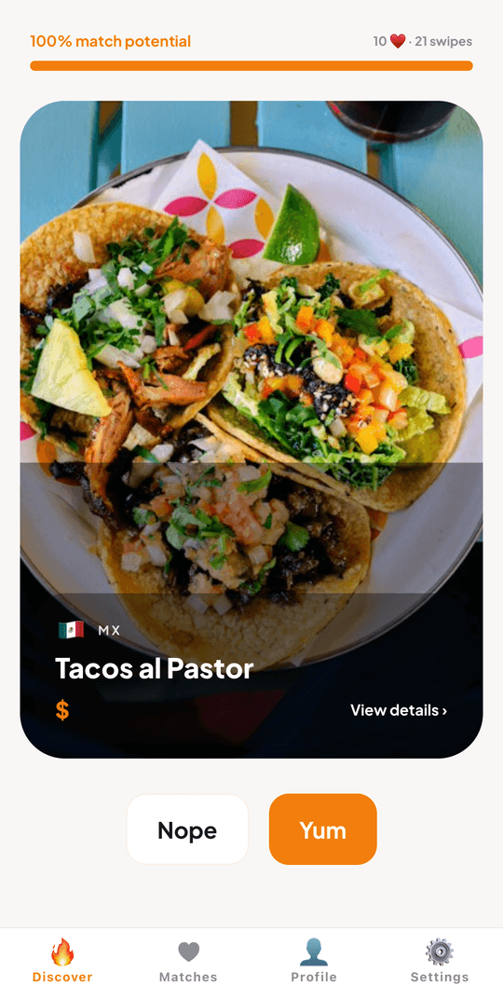
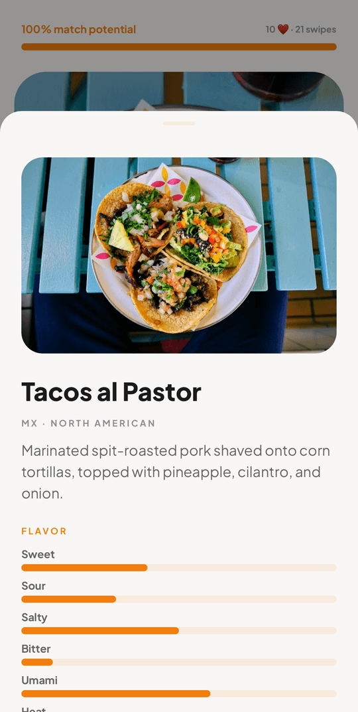
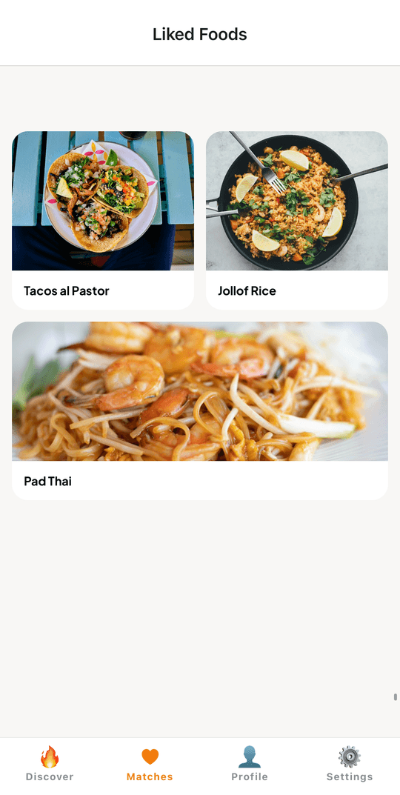
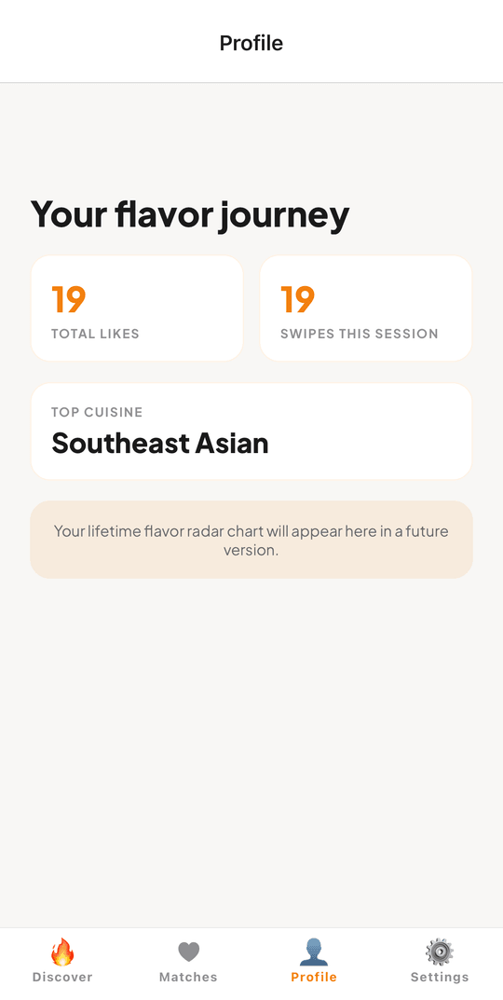
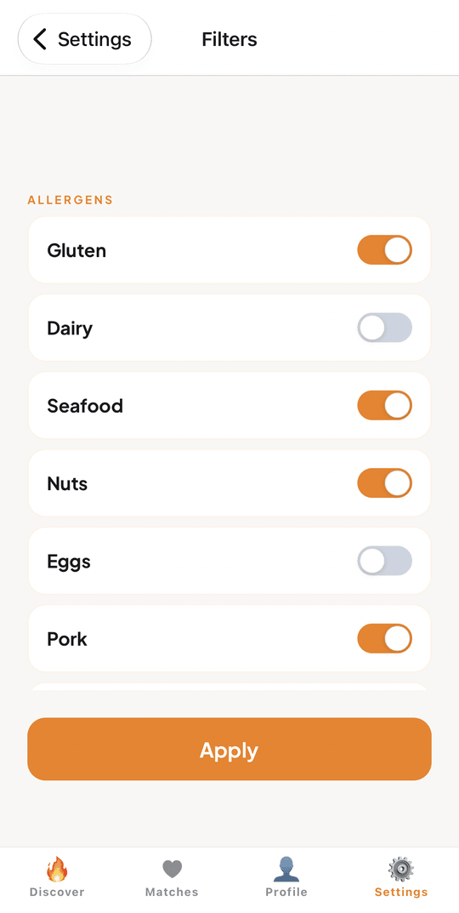

# Munch

A swipe-to-decide food discovery app. Browse dishes like you're swiping on a dating app — YUM to like, NOPE to skip — and Munch learns your taste, eventually revealing a top-3 match it thinks you'll love.

Built with Expo + React Native (New Architecture), TypeScript, Zustand, and Reanimated.


## Screenshots

<p align="center">
  
  
  
  
  
</p>

## Status

A working MVP, paused after the first round of Phase 1 hardening. It runs on a phone via Expo Go, is entirely local (no backend, accounts, or restaurant data), and has 332 curated dishes. Typecheck, 112 tests, and the dish-data validator all pass in CI.

Known limitations:

- **Mostly placeholder images.** 10 dishes (e.g. salmon nigiri, takoyaki, tonkatsu, gyoza, mapo tofu, xiao long bao) have real photos from [Pexels](https://www.pexels.com/license/); the other 300 use seeded `picsum.photos` photos, which are random and don't depict the dish. The tooling for replacing them is built (see [Content tooling](#content-tooling)) but the full picking pass hasn't been done.
- **Analytics and error monitoring are no-ops.** The adapters are wired in; PostHog/Sentry just aren't plugged in yet.
- **Expo Go only.** No EAS dev build or store release yet.

See [`docs/roadmap.md`](docs/roadmap.md) for the plan from here to a public release.

## Features

- **Swipe to discover** — Card stack with gestures, YUM/NOPE badges, and haptics.
- **Match reveal** — After enough likes, Munch scores your session and reveals a top-3 match.
- **Taste learning** — Per-session taste vector + categorical counters drive the recommendation engine.
- **Onboarding** — Diet, allergens, and price range collected up front.
- **Filters & preferences** — Tweak cuisine, price, and dietary rules any time.
- **Liked history** — Revisit every dish you've said YUM to.
- **Offline-first** — Preferences, session, and history persist locally via AsyncStorage.

## Project layout

```
munch/
├── docs/                     # Internal docs (superpowers, etc.)
└── mobile/                   # Expo app
    ├── App.tsx               # Root: fonts, hydration, providers
    ├── app.json              # Expo config
    └── src/
        ├── app/              # Navigation (root, tabs, onboarding stack)
        ├── data/             # Seed data (foods.json, cuisineRegions)
        ├── domain/           # Business logic
        │   ├── dish/         #   Dish repository + types
        │   ├── preferences/  #   User preferences store
        │   ├── recommendation/ # Scoring engine + confidence
        │   └── session/      #   Swipe session, mutations, liked history
        ├── features/         # Screens grouped by feature
        │   ├── discover/     #   Swipe stack, match-potential bar, details
        │   ├── match/        #   Match reveal screen
        │   ├── matches/      #   Liked gallery
        │   ├── onboarding/   #   Welcome, diet, allergens, price
        │   ├── profile/
        │   └── settings/     #   Filters, data management
        ├── shared/           # Theme, components, hooks
        └── __tests__/        # Jest + property-based tests (fast-check)
```

Domain logic is deliberately isolated from UI — the recommendation engine, dish repository, and session mutations are all pure and independently testable.

## Getting started

Requires Node 22+ and the Expo toolchain.

```bash
cd mobile
npm install
npm start          # Expo dev server
npm run ios        # or
npm run android    # or
npm run web
```

## Development

```bash
npm run typecheck      # tsc --noEmit
npm test               # jest
npm run test:watch
npm run test:coverage
```

Path alias `@/*` maps to `mobile/src/*` (see `tsconfig.json`).

## How recommendations work

Each swipe updates a session taste vector over seven flavor axes (sweet, sour, salty, bitter, umami, heat, richness) plus liked/seen counts per cuisine region, meal type, and texture. `RecommendationEngine` combines three scorers (`FlavorSimilarity`, `CategoricalAffinity`, `PopularityTieBreaker`) to rank the remaining dishes. At match time the top 3 are shown with match percentages, and `computeMatchConfidence` (1 minus normalized entropy of the top scores) measures how decisive the result is. Dietary, allergen, and price filters are applied before scoring.

## Content tooling

Dishes live in `mobile/src/data/foods.json`. Scripts in `scripts/` (run from the repo root after `npm install`):

```bash
npm run validate-foods            # schema, duplicates, flavor sanity; also run in CI
npm run compute-thumbhashes       # regenerate blurred image placeholders
npm run fetch-image-candidates    # needs PEXELS_API_KEY in .env; writes scripts/image-candidates.js
# open scripts/image-picker.html in a browser, pick a photo per dish, then download image-selections.json
npm run apply-image-selections    # write the picks into foods.json
```

## Docs

- [`docs/roadmap.md`](docs/roadmap.md): MVP to production plan
- [`docs/phase-1-setup-guide.md`](docs/phase-1-setup-guide.md): Phase 1 steps that need your own accounts
- [`docs/superpowers/`](docs/superpowers/): original MVP design spec and implementation plan

## Tech stack

- **Expo SDK 58** with the New Architecture enabled
- **React 19** / **React Native 0.88**
- **React Navigation** (native-stack + bottom-tabs)
- **Zustand** for state, **AsyncStorage** for persistence
- **Reanimated 4** + **Gesture Handler 3** for swipe interactions
- **expo-haptics**, **expo-blur**, **expo-image**
- **Plus Jakarta Sans** via `@expo-google-fonts`
- **Jest** + **@testing-library/react-native** + **fast-check**

## License

[MIT](LICENSE)
